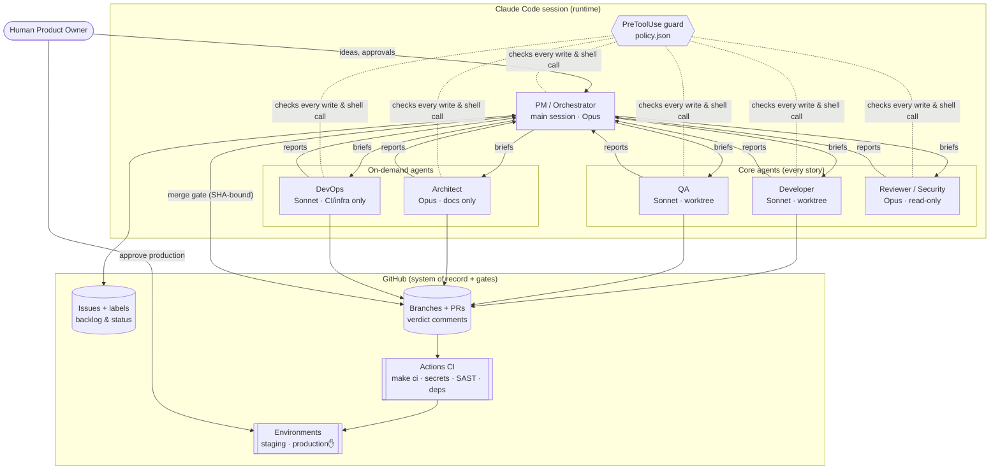

# 1. Architecture proposal

## Decision in one paragraph

For v1 we do **not** build an orchestration platform. We compose the team from existing,
mature parts: **Claude Code** is the agent runtime (one orchestrator session plus five role
subagents, each with its own prompt, model, tools, and isolated git worktree), **GitHub** is the
system of record and control plane (issues = backlog, PRs = units of work, PR comments =
handoffs, Actions = deterministic gates, Environments = human release gates), and
**guardrails as code** (hooks, permissions, CODEOWNERS, branch protection) bound what agents
can do. Custom code is limited to what gives us a clear advantage: role prompts, a policy guard
(~150 lines), playbooks, and a metrics collector. See ADR-0001.

## System view



## Layers

| Layer | v1 implementation | Why |
|---|---|---|
| Agent runtime | Claude Code subagents (`.claude/agents/*.md`) | Role prompts, per-agent tools, model, effort, turn caps and worktree isolation come built in |
| Orchestration | PM agent following playbooks (`/kickoff`, `/deliver`, `/release`, `/board`) | Lightweight. The deterministic parts (gates, deploys) live in GitHub, not in the LLM |
| System of record | GitHub Issues, labels, PRs, comments, releases | Durable, visible to humans, survives ephemeral containers, free |
| Quality gates | GitHub Actions + branch protection + SHA-bound agent verdicts | Deterministic checks the agents cannot talk their way past |
| Human gates | PO approves scope, architecture and production (`production` environment reviewer); `po:approved` for risk:2. Merges are automated behind the SHA-bound merge gate | Humans own irreversible and high-impact actions; reversible integration is automated |
| Guardrails | `guard.py` hook + `policy.json`, permission deny rules, CODEOWNERS | Least privilege per role, enforced even in auto/bypass permission modes |
| Observability | Verdict markers + GitHub timeline → `scripts/metrics.py`; token/cost via Claude Console usage or Claude Code OpenTelemetry | No extra infrastructure in v1 |

## Section-7 requirements mapping

| Requirement | Implementation | Location |
|---|---|---|
| Agent registry | One Markdown file per agent: responsibilities, tools, model, effort, isolation, maxTurns. Write scope and command limits per role in policy | `.claude/agents/`, `.claude/hooks/policy.json` |
| Task management | Story issues with acceptance criteria, risk and status labels, dependencies | `.github/ISSUE_TEMPLATE/story.yml` |
| Workflow orchestration | PM playbooks define sequencing, parallelism and completion criteria | `.claude/skills/*/SKILL.md`, `docs/04-workflow.md` |
| Context management | Fresh context per subagent; briefs pass references (issue #, paths, SHA), not transcripts; capped report sizes | `pm.md` brief format |
| Shared artifacts | Issues (spec), `docs/architecture`, `docs/api`, `docs/adr` (design), PR body (dev handoff), PR comments (QA and review reports) | — |
| Tool integration | git, `gh`, `make` targets, scanners, test runners; MCP servers can be added per agent | agent `tools:` |
| Quality gates | CI required checks; QA `PASS` + review `APPROVE` on the same head SHA; Definition of Done | `CLAUDE.md`, `ci.yml` |
| Human approval gates | G1 scope, G2 architecture, G3 merge, G4 production, G5 sensitive operations | `docs/04-workflow.md` |
| Observability | Verdict markers (`story`, `agent`, `verdict`, `sha`, `cycle`, optional `cost_usd`), GitHub timestamps, usage telemetry | `scripts/metrics.py` |
| Failure recovery | State is external, so any new session resumes with `/board`; work is pushed incrementally; 3-cycle cap then escalation; rollback runbook | `docs/04-workflow.md` §Failure handling |

## Orchestration model: hub and spoke

- The PM is the **only** delegator. Nested delegation is turned off
  (`CLAUDE_CODE_MAX_SUBAGENT_SPAWN_DEPTH=1`), so there are no agent-to-agent conversations
  and no runaway fan-out.
- Parallelism is explicit and limited to independent work: *developer ∥ QA test design*,
  then *QA verification ∥ code review* on the same commit.
- Fix rounds resume the same developer instance when possible. It keeps its context, which costs less.

## Communication: artifacts, not chat

Every handoff is a structured artifact with a fixed shape: the PM brief, the agent's return
report, and the verdict marker. That keeps tokens low and handoffs auditable, and it prevents
"discussion" between models that adds cost without adding verification.

```
<!-- agentic-verdict {"story":12,"agent":"qa","verdict":"PASS","sha":"9f3c…","cycle":2} -->
```

**SHA binding:** a verdict applies only to the commit it names. A new push invalidates
earlier verdicts automatically, so an approval for one commit can never be applied to another.

## State management

Agents are stateless. All durable state lives in GitHub and git:

| State | Where |
|---|---|
| Backlog order, status, risk, PO approval | issue labels and order |
| Spec and acceptance criteria | issue body |
| Code under test | PR head SHA |
| QA and review outcomes, rework cycle | verdict markers in PR comments |
| Escalations and decisions | `ESCALATED` markers + PO replies; ADRs |
| Releases | tags, draft and published releases, environment deployments |

Containers and sessions are disposable. A new session runs `/board` and continues.

## Context management

- `CLAUDE.md` stays short (~1k tokens) because every agent loads it on every run.
- Briefs carry pointers; agents pull what they need (`gh issue view`, file reads).
- Reports are capped (~300 words), so the PM's context grows slowly across stories.
- Prefer one PM session per working block (a story or a day) over one endless session.

## Isolation and trust boundaries

- **Workspaces:** each building agent runs in its own git worktree. QA and the reviewer
  check out the exact SHA detached. Branch namespaces are owned per role
  (`story/`, `qa/`, `design/`, `ops/`) and enforced by the guard.
- **Containment:** file writes stay inside the project checkout and its worktrees. Outside it, only
  temp dirs, Claude's memory files and declared data roots (`AGENTIC_EXTRA_WRITE_ROOTS`) are
  writable, so agents can't edit other projects on a shared machine.
- **Write scopes:** the developer can't touch CI, infra or acceptance tests; QA only tests;
  the reviewer nothing; the architect only `docs/`; devops only CI and infra. Nobody but the PO
  edits `.claude/`, `CLAUDE.md` or CODEOWNERS.
- **Secrets:** agents get a repo-scoped GitHub token and model access only. Deploy
  credentials live in GitHub Environment secrets and are used only by CI jobs. Agents cannot
  read `.env*` or dump the environment.
- **Untrusted input:** external issue text, web pages, tool output and dependency docs
  are data, not instructions (CLAUDE.md rule 4).
- **Limits, stated honestly:** the hook catches mistakes and role drift. It is not a
  sandbox, because a determined process can find shell paths around a regex. The hard boundaries
  are GitHub permissions, branch protection, required checks, environment approvals, and keeping
  production credentials out of agent environments.
- **Identity (planned for M2):** in v1, agents act with the PO's GitHub identity. Moving agents
  to a separate machine account or GitHub App makes "PO approval required" enforceable by
  GitHub (required reviews, CODEOWNERS) and separates the audit trail.

## Evolution path (only when metrics justify it)

| Trigger | Add |
|---|---|
| Want event-driven work without an open session (for example, label a story → agent starts) | Claude Code GitHub Action (`anthropics/claude-code-action@v1`) running `/deliver` in CI |
| Need unattended, long-running, multi-story pipelines with a deterministic state machine and checkpointed recovery | Claude Agent SDK workers orchestrated by LangGraph (or Microsoft Agent Framework in a .NET/Azure shop) |
| Measured bottleneck in implementation | Second developer agent (worktrees already isolate it), then frontend/backend specialization |
| Domain-heavy projects | Specialist agents from `specialists/` |

Because state and contracts live in GitHub, each step swaps the runtime without changing the
artifacts, gates or metrics.
