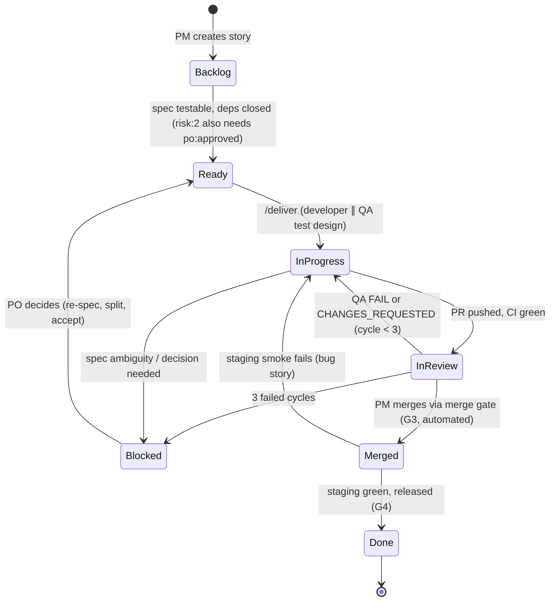
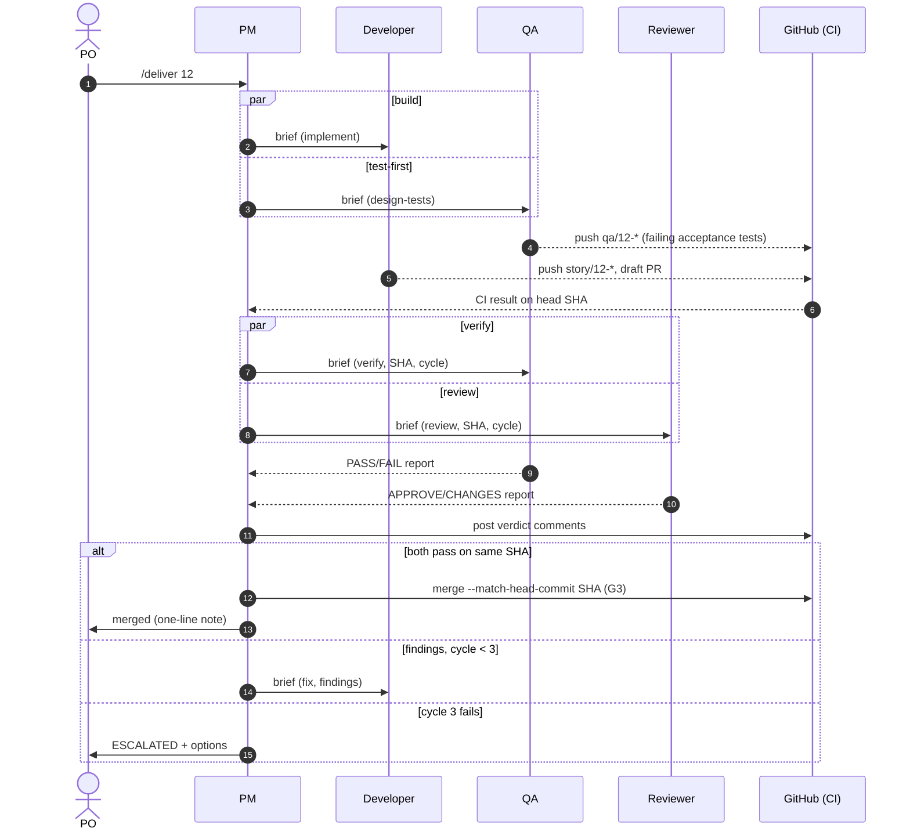

# 4. Workflow design

Kanban with weekly prioritization. No simulated ceremonies: coordination happens through
the board, briefs, and verdicts.

## Story lifecycle

Labels: `status:backlog`, `status:ready`, `status:in-progress`, `status:in-review`,
`status:ready-for-release` (merged, waiting for production), `status:blocked`. The issue closes when its PR merges.

## Phases

| # | Phase | Responsible | Consulted | Deliverables | Exit gate |
|---|---|---|---|---|---|
| 1 | Requirements and planning | PM | PO | brief issue, epics, stories with acceptance criteria, prioritized backlog | **G1** PO approves scope and order |
| 2 | Architecture and design | Architect | PM, PO | architecture notes, API and data contracts, ADRs, story breakdown, walking-skeleton spec | **G2** PO merges design PR |
| 3 | Implementation | Developer (∥ QA test design) | Architect for risk:2 | code, unit tests, acceptance tests, PR with handoff | CI green on head SHA |
| 4 | Testing and QA | QA | — | verdict report, defects, regression tests | QA `PASS` on head SHA |
| 5 | Code and security review (∥ phase 4) | Reviewer | Human reviewer for risk:2 | verdict report, scanner results | `APPROVE` on the same SHA |
| 6 | Integration and deployment | DevOps | PM | merged change, staging deploy, smoke results, draft release, rollback plan | **G3** automated merge gate; **G4** PO approves production |

## Sequence for one story

## Gates

> **Merge policy (PO decision, Oct 2026):** agents merge autonomously through the merge gate. Production stays human-approved.

**Automated (deterministic, required checks on `main`):** `make ci` (lint, types, unit and
acceptance tests, ecosystem audit), secret scan (gitleaks), static analysis (Semgrep), and
dependency review on PRs.

**Agent gates (independent, SHA-bound):** QA `PASS` and reviewer `APPROVE` on the PR head SHA.
The author's self-report never counts.

**Human gates:**

| Gate | Decision | Mechanism |
|---|---|---|
| G1 Scope | Business goals, MVP, backlog order (weekly) | PO replies on the brief and planning comment |
| G2 Architecture | Stack, ADRs, build vs buy, vendors | PO approves `design:` PR; the PM merges it |
| G3 Merge (automated, PO decision) | Every story PR | PM merges only with CI green + QA PASS + APPROVE on the same SHA, via `gh pr merge --match-head-commit`. GitHub branch protection refuses red checks; the guard blocks `--admin` and merges by any other agent. Exceptions needing the PO's OK: `design:` PRs, CI-workflow changes, and risk:2 when `risk2_human_merge` is on |
| G4 Production | Every production release | PO publishes the draft release, then approves the `production` environment |
| G5 Sensitive operations | Secrets, real money, real user data, destructive operations, compliance | Agents prepare; humans execute |

## Risk tiers

| | risk:0 | risk:1 | risk:2 |
|---|---|---|---|
| Examples | docs, copy, styles, tooling | normal features | auth, payments, money math, PII, migrations, infra, integrations |
| PO approval before start | — | — | `po:approved` |
| Architect | — | if design changes | required design note |
| QA test-first | optional | yes | yes, including negative and security cases |
| Reviewer effort | medium | high | max, plus a list of items for human review |
| Human attention | — | — | reviewer lists items for the PO; optional `risk2_human_merge` |
| Optional cross-vendor second review | — | — | trial in M3 |

## Failure handling

| Situation | Response |
|---|---|
| QA FAIL and/or CHANGES_REQUESTED | PM merges findings into one numbered list, then sends it to the developer (fix mode, same instance if possible). `cycle += 1` |
| 3 failed cycles | `status:blocked`, `ESCALATED` marker, options plus recommendation to the PO (re-spec, split, architect review, accept with follow-up) |
| CI red before verification | Developer fixes it; QA and review don't start (saves tokens). Not counted as a cycle |
| Spec ambiguity found by any agent | The agent returns `BLOCKED` with a question. The PM answers from the spec or escalates |
| Developer disputes an acceptance test | PM arbitrates against the acceptance criteria and routes the fix to QA or the developer; unclear criteria go to the PO |
| Flaky test | Logged as a defect. A test may be retried once to classify it, never retried until it passes |
| Agent crash, timeout, or turn cap | PM restarts from the last pushed commit (agents push incrementally). A second failure is escalated |
| Session or container lost | Nothing is lost that matters: a new session runs `/board` and resumes from GitHub |
| Guardrail block | The agent reports it and does not work around it. The PM escalates if the need is legitimate |
| Staging smoke fails | Release stops; bug issue; story returns to `status:in-progress`; staging redeploys the last good SHA |
| Production incident | Rollback first (`docs/runbooks/rollback.md`, human-approved), then a fix-forward story through the normal flow |

## Cadence

- **Continuous:** stories flow one at a time per developer agent (work-in-progress limit 1
  with one developer). QA and review run in parallel.
- **Weekly (async):** the PM posts a planning comment on the brief issue covering what shipped, the
  metrics summary, the proposed next priorities, and the risks. The PO approves or reorders it (G1).
- **Per release:** `/release` when a coherent set of stories is merged.

## Scaling the developer role

1. Start with **one developer** (configuration C2).
2. Add a **second developer** only when the metrics show implementation is the bottleneck
   (stories wait in `Ready`, QA and review idle) *and* the backlog has independent stories with
   non-overlapping files. Each developer gets its own worktree and story. The PM never assigns
   two in-flight stories that touch the same module without an explicit integration order.
3. Consider frontend, backend, integration or ML specialization only after C3 beats C2 on
   cost-adjusted throughput without hurting quality (see `docs/06-evaluation.md`).
